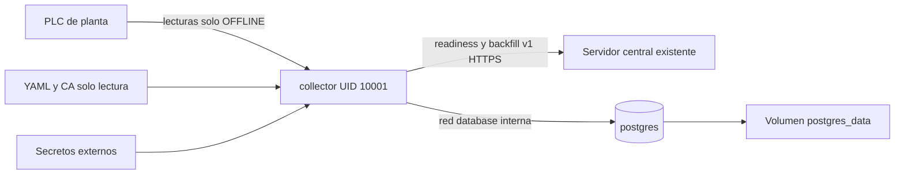

# Arquitectura Docker del Collector Offline

Una misma imagen `linux/amd64` ejecuta la aplicación existente en cada planta. El YAML,
credenciales y datos son externos. La auditoría y diferencias respecto de la referencia
están en [docs/AUDITORIA_DOCKER.md](docs/AUDITORIA_DOCKER.md).

## Servicios y redes

`collector` mantiene Supervisor, LocalCollector, SyncWorker y CleanupWorker en su proceso
actual. La API local escucha únicamente loopback del contenedor; se consulta con
`docker compose exec`. No se publican puertos ni se usa host networking, privileged o
socket Docker. `database` es interna y une solo aplicación/BD; `uplink` da salida mediante
bridge/NAT a los destinos PLC y central usando las rutas del anfitrión. No hace discovery
PLC por broadcast; se usan destinos unicast configurados.

PostgreSQL usa la imagen oficial 18.7 Bookworm fijada por digest. El esquema no requiere
extensiones. La elección de 18 es explícita para instalaciones nuevas y se apoya en la
compatibilidad del SQL, no en una supuesta versión de un dump. **No monte un volumen de
otra versión mayor directamente.** Para migrar datos use dump/restore y verifique en pruebas.
En PostgreSQL >=18 el volumen se monta en `/var/lib/postgresql`; el motor administra su
subdirectorio por versión. [Referencia de la imagen oficial](https://hub.docker.com/_/postgres).

## Inicialización y almacenamiento

| Elemento | Persistencia | Uso |
|---|---|---|
| Volumen `postgres_data` del proyecto Compose | Docker volume local | Datos, WAL, pendientes, leases, sesiones y último estado |
| `runtime/config/` | Anfitrión, montado ro | `site.yml`, includes y CA corporativa |
| `runtime/secrets/` | Anfitrión, fuera de Git | Passwords BD, token y credenciales opcionales PLC |
| `backups/` | Anfitrión | Dumps custom, hashes, configuración anterior de versión |
| stdout/stderr | Docker json-file | Rotación 5 archivos de 10 MB por servicio |

No hay outbox/spool de archivos en el programa; la BD es su outbox. Un volumen adicional
de archivos no mejoraría su recuperación. Los YAML originales siguen admitiendo includes
relativos y tags escalares/enriquecidos. El cambio de configuración requiere recrear o
reiniciar el Collector, sin reconstruir imágenes.

La inicialización oficial PostgreSQL ejecuta `docker/postgres-init.sh` solo en un volumen
nuevo. Crea un rol de aplicación sin superusuario, propietario de la BD y esquema public.
El administrador PostgreSQL usa otro secreto. El Collector ejecuta el migrador versionado
existente al arrancar; registra cada SQL una sola vez dentro de una transacción.
No se monta un SQL destructivo en cada arranque. El SQL original no se modifica.
`depends_on: service_healthy` espera `pg_isready` antes de iniciar la aplicación.
[Orden y salud en Compose](https://docs.docker.com/compose/how-tos/startup-order/).

## Fallos y cierre

Las transiciones, captura por minuto UTC, cierre de eventos al recuperar, protocolo de
backfill y retención de 90 días se conservan. Tras apagado se recuperan estado y leases.
Un claim no confirmado conserva el registro; un reenvío mantiene sus identificadores.
No se borran pendientes ni failed ni eventos abiertos. Para usar la recomendación documental
de 30 días, un administrador debe decidirlo y modificar `retention.days`; no se aplica aquí.

`init: true` reenvía señales; SIGTERM activa el cierre existente. Se esperan 180 s antes
del kill del runtime. Muchos PLC/módulos o timeouts mayores pueden exigir aumentar
`STOP_GRACE_PERIOD` por encima del tiempo máximo de un ciclo; una terminación forzada
no sustituye la garantía de recuperación transaccional. `unless-stopped` reinicia procesos
que terminan y restaura el servicio al arrancar Docker después de un corte.
Una parada administrativa explícita permanece detenida hasta `start.sh`.

Healthcheck de PostgreSQL: `pg_isready`. Healthcheck del Collector: readiness HTTP local
que consulta el estado y backlog en la BD. OFFLINE con BD disponible es saludable;
la caída central no provoca bucles de reinicio. La salud no demuestra que se estén leyendo
tags válidos. Revise logs `minute_rows/event_rows`, estado y marcas de tiempo.
Docker no reinicia por `unhealthy` solamente; ante bloqueo con proceso vivo, investigue
con `diagnose.sh`/logs y haga reinicio controlado. No se añade un watchdog con privilegios.

## Seguridad y límites

Imagen de aplicación sin datos de planta y UID/GID 10001, root filesystem ro, tmpfs acotado,
capabilities vacías y no-new-privileges. Límites iniciales: app 512 MiB/1 CPU, BD 1 GiB/1 CPU;
ajustar con mediciones, especialmente en backlogs grandes. El entrypoint oficial de
PostgreSQL usa root inicialmente para preparar permisos y baja al usuario postgres para
el motor; la aplicación nunca usa ese rol.

Los secretos Compose locales son archivos bind montados, **no un almacén cifrado**. El
padre `runtime/secrets` es root 0700; token/PLC son UID 10001 modo 0400. Los dos passwords
BD son 0444 dentro de sus bind mounts para que el init PostgreSQL y la app puedan leerlos;
el directorio padre impide lectura por usuarios del anfitrión sin privilegios. No imprimir
secretos con `cat`, `docker inspect` de env ni adjuntarlos a diagnósticos.
Se soportan variables y su variante `_FILE`, mutuamente excluyentes.

HTTPS verifica certificados. Se conserva la excepción existente de HTTP por IP privada
con opt-in, que no cifra el token: preferir HTTPS o túnel de red aprobado antes de activarla.
La autorización central de nodo/laguna/tag y la ausencia de WS/notificaciones se mantienen
en el contrato del servidor existente; no se modificó el Collector Central.
La auditoría de dependencias y el aviso residual OPC UA se detallan en
[docs/SEGURIDAD_DEPENDENCIAS.md](docs/SEGURIDAD_DEPENDENCIAS.md).

No hay un firewall universal dentro del contenedor: el administrador debe restringir
egress según PLC/central/DNS/NTP y considerar reglas de forwarding Docker. No confiar solo
en UFW para tráfico encaminado por bridges. No se exponen puertos PLC a Internet.
