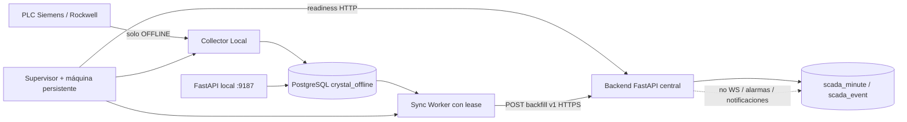
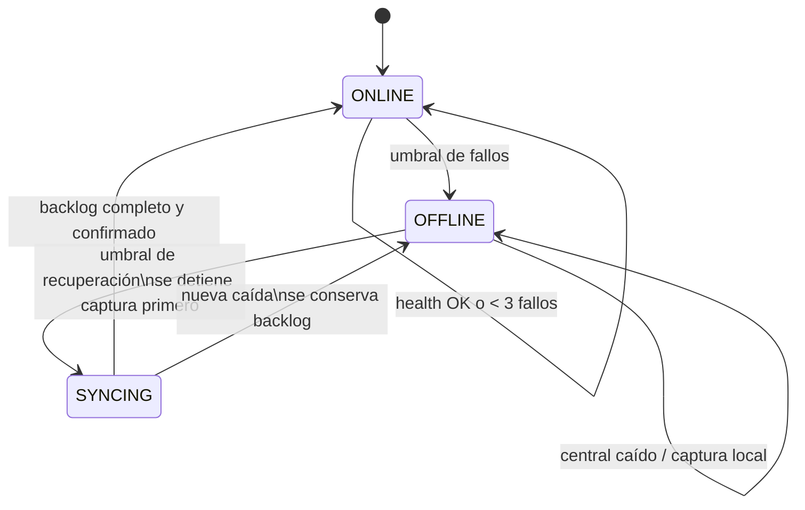

# Collector Offline

Nodo local de contingencia SCADA para Crystal Lagoons, ejecutado en Ubuntu Server 24.04.
El Collector Central sigue siendo la fuente oficial: mientras el backend está `ONLINE`, este
servicio no lee PLCs. Tras tres fallos consecutivos del readiness central abre una sesión,
captura localmente por minuto y, al recuperar conexión, detiene primero la captura y envía el
histórico por un endpoint FastAPI sin efectos realtime.

La configuración incluida está preparada para `small_sim` y utiliza una copia local
autosuficiente: [`config/small_sim.yml`](config/small_sim.yml). No referencia archivos del
Collector Central durante la desconexión.

## Arquitectura



El proceso es único y las transiciones se centralizan en `StateCoordinator`. Una conexión
PostgreSQL mantiene un advisory lock durante toda la vida del proceso. Los registros reclamados
para sync tienen además lease y `FOR UPDATE SKIP LOCKED`, por lo que un crash los devuelve a
`pending` al expirar.



## Configuración actual: `small_sim`

[`config/collector-offline.yml`](config/collector-offline.yml) contiene:

```yaml
node:
  source_node_id: "edge-small-sim-01"
  lagoon_id: "small_sim"
  product_type: "small"

plcs:
  - include: "small_sim.yml"
```

La copia local actual selecciona Rockwell en `192.168.100.11` y lee los tags `motor` y
`partir`. El campo `backend` presente en la copia se ignora deliberadamente; el offline nunca
llama al endpoint realtime.

El backend central se consulta cada 60 segundos en `192.168.2.100`. Como actualmente solo
ofrece HTTP en la red privada de planta, el YAML habilita explícitamente
`central.allow_private_http: true`; HTTP público continúa rechazado.

Para otra laguna:

1. Copiar su YAML oficial a `/etc/crystal/collector-offline/<laguna>.yml`.
2. Cambiar solo `node.source_node_id`, `node.lagoon_id`, `node.product_type` y
   `plcs[0].include` en `collector-offline.yml`.
3. Registrar ese `source_node_id`, laguna y hash de token en el backend central.
4. Reiniciar y comprobar `/health/ready`.

Drivers, tags, tipos automáticos, tablas, migraciones, captura y sync se resuelven desde esos
YAML. Se soportan las fuentes existentes: `siemens`, `rockwell` y `simulator`. Un tag escalar
mantiene compatibilidad con el Collector Central; opcionalmente se puede enriquecer localmente:

```yaml
tags:
  P001_ST:
    address: "P001_ST"
    data_type: state
    event: true
    label: "Bomba de recirculación"
```

Sin `event`, el modo automático replica las reglas centrales para booleanos, estados `0..3` y
sufijos `.ST`, `_ST`, `_STS`, `_ST_SCADA`, `_STS_SCADA`.

### Selección Siemens o Rockwell desde YAML

El selector es `source`, igual que en el Collector Central. No hay que cambiar código Python.
Para Siemens:

```yaml
source: siemens
siemens:
  opc_server_url: "opc.tcp://192.168.17.10:4840"
  timeout_sec: 5
tags:
  PT117_R_SCADA: "ns=4;i=3"
```

Para Rockwell:

```yaml
source: rockwell
force_reconnect_every_sec: 3600
max_consecutive_fails: 10
rockwell:
  ip: "192.168.26.10"
  slot: 0
  timeout_sec: 5
tags:
  PT203_R: "PT203_R"
  P300_ST: "P300_ST"
```

Rockwell mantiene una conexión persistente, lee los tags en batch y rota la sesión con los
mismos parámetros del Collector Central. La plantilla lista para copiar está en
[`config/rockwell-example.yml`](config/rockwell-example.yml). Al desplegar, el instalador copia
todos los YAML locales nuevos sin sobrescribir los que ya fueron configurados en la VM.

## Base de datos separada

El nodo usa exclusivamente `crystal_offline`; nunca escribe directamente en `crystal_plc`.
En Ubuntu, el script crea el usuario de sistema/rol PostgreSQL `collector_local`, la base
`crystal_offline` y autenticación peer por socket local:

```bash
sudo bash scripts/provision-postgres.sh
export COLLECTOR_OFFLINE_DATABASE_URL='postgresql+psycopg2:///crystal_offline'
collector-offline migrate --config config/collector-offline.yml
```

La migración versionada está en
[`migrations/local/001_initial.sql`](migrations/local/001_initial.sql). Contiene constraints,
índices de pendientes/sesiones/tags, timestamps `timestamptz`, unicidad por bucket y la fila
persistente de estado.

Para enviar solamente la migración y ejecutarla por SSH desde Windows:

```powershell
.\scripts\deploy-schema-ssh.ps1 -Server 192.168.100.20
```

El destino puede usar el usuario definido en `~/.ssh/config`; también puede indicarse
explícitamente con `-User`. El script copia
[`scripts/apply-initial-schema.sh`](scripts/apply-initial-schema.sh) y `001_initial.sql`,
verifica ambos hashes SHA-256 y crea idempotentemente la base, el rol y las tablas. Use
`-UploadOnly` si solo desea transferir los archivos sin modificar PostgreSQL. Si el servidor
requiere contraseña de SSH o `sudo`, ejecútelo desde una terminal con `-Interactive`; la
contraseña no se almacena:

```powershell
.\scripts\deploy-schema-ssh.ps1 -Server 192.168.100.20 -Interactive
```

## Instalación en Ubuntu 24.04

```bash
sudo bash scripts/install.sh
sudoedit /etc/crystal/collector-offline.env
sudoedit /etc/crystal/collector-offline/collector-offline.yml
sudo systemctl start collector-offline
sudo systemctl status collector-offline
```

Antes de iniciar, aplique en el backend central:

```bash
psql "$CENTRAL_DATABASE_URL" -f crystal-backend/scripts/create_offline_backfill.sql
TOKEN="$(openssl rand -hex 32)"
TOKEN_HASH="$(printf %s "$TOKEN" | sha256sum | awk '{print $1}')"
```

Inserte `edge-small-sim-01`, `small_sim` y `$TOKEN_HASH` en
`offline_collector_node`; guarde el token plano únicamente como
`COLLECTOR_OFFLINE_TOKEN` en `/etc/crystal/collector-offline.env` con permisos `0600`.
El endpoint central es `POST /ingest/offline/v1/backfill` y autentica
`Authorization: Bearer` por nodo y laguna.

El servicio systemd reinicia automáticamente, maneja `SIGTERM/SIGINT`, no tiene privilegios y
restringe filesystem/capabilities. Los logs JSON salen a journald, que administra rotación:

```bash
journalctl -u collector-offline -f -o cat
journalctl --disk-usage
```

Configure en `journald.conf` límites corporativos (`SystemMaxUse` y `MaxRetentionSec`) si los
defaults del servidor no cumplen la política de retención.

## Estado operativo FastAPI

La API local solo escucha loopback:

- `GET http://127.0.0.1:9187/health/live`
- `GET http://127.0.0.1:9187/health/ready`
- `GET http://127.0.0.1:9187/status`

`/status` entrega estado, última comprobación central, sesión activa, backlog por estado, última
sincronización y último error. También está disponible por CLI:

```bash
collector-offline status --config /etc/crystal/collector-offline/collector-offline.yml
bash scripts/smoke-test.sh
```

## Seguridad y red

- PostgreSQL escucha solo socket local o loopback; no publicar 5432.
- Permitir desde el nodo únicamente salida al PLC configurado y TCP 443 al backend central.
- No abrir 9187: la API FastAPI local está fijada a loopback por validación.
- TLS y certificados son obligatorios para URLs no loopback. Se admite una CA corporativa en
  `central.ca_bundle`; `verify_tls: false` se rechaza.
- No registrar tokens ni payloads completos. Los logs incluyen componente, nodo, estado,
  sesión y correlation ID cuando corresponde.
- Mantener YAML en `0640` y el archivo de entorno en `0600`.

Ejemplo UFW, ajustando IP/puerto OPC UA reales:

```bash
sudo ufw default deny incoming
sudo ufw allow OpenSSH
sudo ufw default deny outgoing
sudo ufw allow out to 192.168.100.10 port 4840 proto tcp
sudo ufw allow out 443/tcp
```

No aplique esas reglas sin confirmar DNS/NTP/repositorios y la red de administración del sitio.

## Sincronización e idempotencia

- Transporte al menos una vez; `sent` solo tras `accepted` o `duplicate` explícito.
- Minutos: idempotencia central `(lagoon_id, tag_id, bucket)`.
- Eventos: UUID local preservado; un reenvío solo puede completar `end_ts`.
- `429`, `5xx`, red y timeouts son reintentables con backoff exponencial y jitter.
- `401/403/4xx` de contrato y rechazos permanentes quedan `failed` para intervención.
- Si el proceso muere, leases vencidos vuelven a `pending` al arrancar.
- Un registro `failed` impide cerrar la sesión y nunca se elimina por retención.

El detalle campo a campo está en [`docs/MAPPING.md`](docs/MAPPING.md).

## Desarrollo y pruebas

```bash
python3.12 -m venv .venv
source .venv/bin/activate
pip install -e '.[plc,dev]'
pytest -q
ruff check .
mypy src
```

Para la integración PostgreSQL real use una base desechable ya creada:

```bash
TEST_DATABASE_URL='postgresql+psycopg2:///crystal_offline_test' pytest -m postgres -q
```

La suite simulada cubre estabilidad ONLINE, umbral de tres fallos, buckets sin duplicados,
eventos, recuperación, sync parcial, reinicios OFFLINE/SYNCING, leases, nueva caída, errores
permanentes/reintentables, retención, doble claim y UTC.

## Troubleshooting

- `another Collector Offline instance...`: ya existe un proceso con advisory lock; revisar
  `systemctl status` antes de iniciar otro.
- Backlog `failed`: consultar `last_sync_error`, corregir token/tag/contrato y ejecutar
  `collector-offline retry-failed --config /etc/crystal/collector-offline/collector-offline.yml`.
  No se borra ni reencola solo.
- `central readiness ... degraded`: `/health/ready` central no puede usar PostgreSQL; el nodo no
  vuelve a ONLINE solo por recibir ping.
- Sin lecturas OPC UA: validar IP, puerto 4840, namespace IDs de la copia local y paquete
  opcional `plc`.
- Cambio de tags: actualizar primero el YAML central, confirmar registro realtime y copiar la
  versión aprobada al archivo local antes de reiniciar.

Decisiones y riesgos pendientes: [`docs/DECISIONS.md`](docs/DECISIONS.md).

Guía completa de despliegue en VM Linux:
[`docs/MIGRACION_VM_UBUNTU.md`](docs/MIGRACION_VM_UBUNTU.md).
